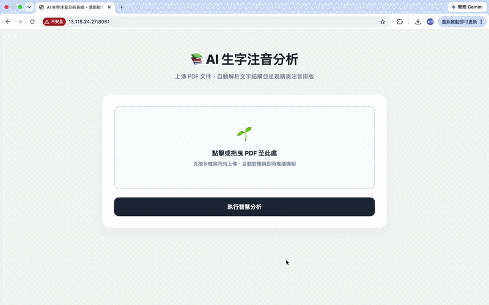
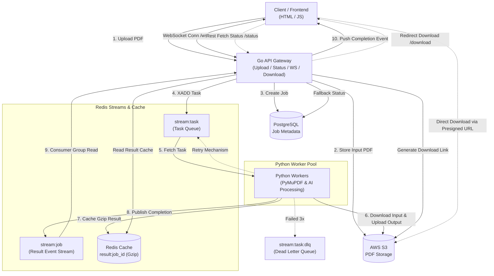
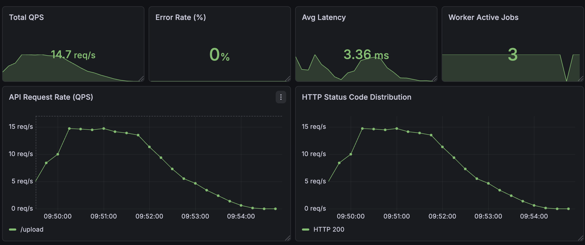
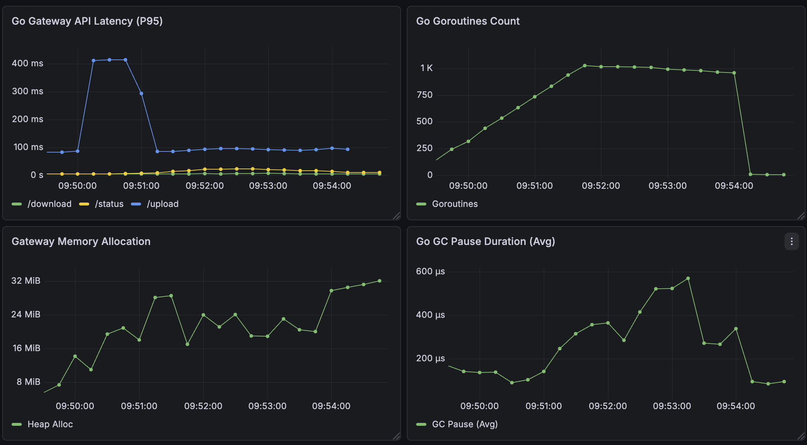
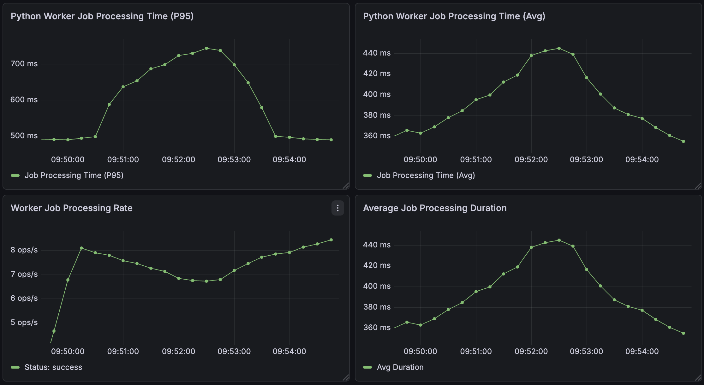
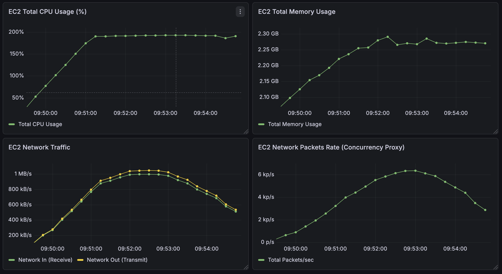

# Distributed Document Processing System

An event-driven distributed document processing system for asynchronous PDF Zhuyin (注音) annotation, built with **Go**, **Python**, **Redis Streams**, **PostgreSQL**, and **AWS S3**.

The system decouples request handling from document processing using Redis Streams Consumer Groups, enabling scalable background processing, fault tolerance, and real-time job tracking.

---

## Demo



---

## Highlights

### Scalable Processing
- Event-driven architecture using Redis Streams Consumer Groups
- Asynchronous document processing with a Go Gateway and Python worker pool

### Fault Tolerance
- Automatic retry mechanism
- Dead Letter Queue (DLQ)
- Pending message recovery using `XAUTOCLAIM`

### Distributed Storage
- AWS S3 for document storage
- PostgreSQL for job metadata
- Redis cache with Gzip-compressed annotation results

### DevOps
- Docker Compose deployment
- Automated CI/CD with GitHub Actions

### Observability *(Work in Progress)*
- Prometheus metrics
- Grafana dashboards
- k6 load testing scripts

---

# System Architecture



A static version of this diagram: [`docs/images/system_architecture.png`](./docs/images/system_architecture.png).

---

# Tech Stack

| Layer | Technology |
|--------|------------|
| API Gateway | Go |
| Background Worker | Python |
| Message Queue | Redis Streams |
| Database | PostgreSQL |
| Object Storage | AWS S3 |
| Cache | Redis |
| Monitoring | Prometheus |
| Dashboard | Grafana |
| Load Testing | k6 |
| Containerization | Docker |
| CI/CD | GitHub Actions |

---

# Processing Flow

### 1. Upload

The client uploads a PDF through the Go API Gateway.

- PDF is uploaded to AWS S3
- Job metadata is stored in PostgreSQL
- A processing task is appended to Redis Streams

---

### 2. Background Processing

Python workers consume tasks through Redis Streams Consumer Groups.

Each worker:

- downloads the PDF from S3
- extracts document contents
- generates Zhuyin annotations
- renders the annotated PDF
- uploads the annotated document back to S3

---

### 3. Result Publication

After processing,

- annotation results are compressed with Gzip
- cached in Redis
- completion events are published back to Redis Streams
- the Gateway updates the job status

Clients can track progress via:
- WebSocket notifications: Instant push upon job completion.
- REST API (`GET /status`): Polls Redis cache with a database fallback for current job status.

---

### 4. File Download

Clients request document download via the Go API Gateway (`GET /download`).

- Gateway verifies job status from Redis Cache.
- Gateway generates a short-lived (10-minute) **AWS S3 Presigned URL**.
- Gateway responds with an HTTP 302 Redirect to direct the client to download the rendered PDF straight from AWS S3, offloading file transfer traffic from the API Gateway.

---

# Features

## Event-driven Architecture

The system separates request handling from document processing by introducing Redis Streams between the API Gateway and worker pool.

This design enables

- asynchronous execution
- worker scalability
- loose coupling between services

---

## Fault Tolerance

Workers implement several reliability mechanisms.

### Consumer Groups

Multiple workers consume tasks concurrently while ensuring each job is processed only once.

### Retry

Failed jobs remain in the Pending Entries List and are retried automatically.

### Pending Recovery

Workers periodically reclaim abandoned tasks using

```
XAUTOCLAIM
```

to recover jobs from crashed workers.

### Dead Letter Queue

Jobs that exceed the retry threshold are moved into a Dead Letter Queue for further inspection instead of being discarded.

---

## Distributed Storage

### AWS S3

Stores

- uploaded PDFs
- annotated PDFs

### PostgreSQL

Stores

- job status
- S3 object locations
- metadata

### Redis Cache

Stores compressed annotation results for fast status retrieval.

---

## Real-time Job Tracking

Clients can monitor processing progress through

- REST polling
- WebSocket notifications

without waiting for synchronous processing.

---

## CI/CD

The workflow in `.github/workflows/ci.yml` keeps checks and deployment separate:

| Event | What runs |
|---|---|
| Pull request to `master` | flake8 and `golangci-lint`, `pytest` and `go test -race`, `docker compose config` validation, and image builds (nothing is pushed or deployed) |
| Push to `master` (after a merge) | everything above, then the images are pushed to GHCR tagged `latest` and with the commit SHA, and the app is deployed to AWS EC2 |
| Manual run (`workflow_dispatch`) | same as a push; an optional `image_tag` input redeploys an earlier commit (rollback) |

Notes:
- Image builds wait for the tests, and deployment waits for the builds.
- Deployment only runs when the repository variable `DEPLOY_ENABLED` is `true`, so the pipeline does not fail while no host is running.
- The deploy job copies the compose file to the host, records the deployed tag as `IMAGE_TAG` in the host's `.env`, runs `docker compose pull` and `up -d`, and finishes with a smoke test against the gateway.

---

# Reliability Design

This project implements several production-inspired backend patterns.

| Feature | Implementation |
|----------|----------------|
| Message Queue | Redis Streams |
| Consumer Group | ✓ |
| Retry | ✓ |
| Pending Recovery | XAUTOCLAIM |
| Dead Letter Queue | ✓ |
| Object Storage | AWS S3 |
| Metadata Database | PostgreSQL |
| Result Cache | Redis |
| Gzip Compression | ✓ |
| Multi-process Workers | ✓ |

---
# Load Testing & System Benchmarks

Current testing coverage includes:
- Python (`pytest`) and Go (`go test -race`) unit tests, run on every pull request
- k6 load, benchmark, breakpoint and spike tests, including an end-to-end lifecycle test (upload → status → download)

> **Note:** The end-to-end and spike results below (sections 2 to 4) were measured before a fix to the worker, which at that time rendered the output PDF from a 10-character preview instead of the whole document, so the per-job processing cost was understated. The upload ingestion results (section 1) only exercise the gateway and are not affected. The end-to-end numbers will be re-measured.

---

## 1. Upload API Ingestion Benchmark

Evaluated Go Gateway upload throughput using fixed concurrent users submitting PDF payloads directly to `/upload`.

* **Tool:** k6  
* **Script:** `upload_benchmark.js`  
* **Workload:** Fixed VUs (`duration: 2m`)  
* **Environment:** AWS EC2 Deployment  

| Concurrent Users (VUs) | Avg Latency | P95 Latency | Throughput (req/s) | Error Rate |
|---|---:|---:|---:|---:|
| 10 | 85.5 ms | 98.77 ms | 9.20 req/s | 0.00% |
| 50 | 88.37 ms | 116.11 ms | 45.85 req/s | 0.00% |
| 100 | 91.12 ms | 123.95 ms | 91.04 req/s | 0.00% |
| 200 | 107.16 ms | 200.32 ms | 179.59 req/s | 0.00% |
| 500 | 306.31 ms | 989.09 ms | 380.24 req/s | 0.00% |
| 1,000 | 1.59 s | 2.48 s | 382.08 req/s | 0.00% |

> **Key Finding:** Ingestion throughput scales linearly up to **200 VUs**, after which it saturates at **~380 req/s** (500–1,000 VUs). P95 latency increases past 500 VUs (~989 ms → 2.48 s), signaling Gateway CPU/bandwidth bounds without incurring HTTP connection drops (0.00% error rate).

---

## 2. End-to-End Lifecycle Benchmark (Fixed VUs)

Evaluated complete workflow performance (`Upload -> Poll Status -> Worker Processing -> Download`) across low-to-medium concurrency levels.

* **Tool:** k6  
* **Script:** `mixed_life_cycle_benchmark.js`  
* **Workload:** Fixed VUs (`maxRetries: 60`)  
* **Environment:** AWS EC2 Deployment  

| Concurrent Users (VUs) | Avg E2E Time | P95 E2E Time | Worker Throughput | Success Rate |
|---|---:|---:|---:|---:|
| 10 | 1.77 s | 1.77 s | 5.61 ops/s | 100.00% |
| 20 | 2.51 s | 2.82 s | 7.90 ops/s | 100.00% |
| 50 | 6.15 s | 7.11 s | 7.95 ops/s | 100.00% |
| 100 | 12.06 s | 13.37 s | 7.93 ops/s | 100.00% |

> **Key Finding:** Worker execution capacity saturates at **~8 ops/s** beyond 20 VUs. Excess incoming traffic is safely buffered inside Redis Streams; the system trades queueing dwell time (E2E latency) to ensure service availability.

---

## 3. Breakpoint & System Resilience Test

Evaluated system execution limits and queue resilience by ramping traffic step-by-step up to **1,000 concurrent VUs**.

* **Tool:** k6  
* **Script:** `breakingpoint_test.js`  
* **Test Profile:** Stage Ramp-up (0 → 1,000 VUs over 2m10s)  
* **Environment:** AWS EC2 Deployment  

| Key Metric | Measured Value | Analysis & Architectural Insights |
| :--- | ---: | :--- |
| **Check Success Rate** | **100.00%** (87,142 / 87,142) | All completed status polling and payload checks succeeded without application drops. |
| **HTTP Error Rate** | **0.00%** (0 / 87,142 reqs) | Go Gateway maintained 0% HTTP request failures under 1,000 VUs. |
| **HTTP P95 Latency** | **51.11 ms** | API Gateway response time remained fast (<60ms) during status polling pressure. |
| **E2E Duration Range** | **1.74s (Min) → 1m17s (P95)** | Queue dwell time scaled naturally with concurrency while maintaining complete job processing integrity. |

---

## 4. Spike & Drain Test

System telemetry captured during the **Spike & Drain Scenario** (`mixed_life_cycle_baseline.js`: 200 VU Warm-up → 1,000 VU Surge → 0 VU Queue Drain).

| Key Metric | Measured Value |
| :--- | ---: |
| **Peak Concurrent VUs** | **1,000** |
| **HTTP Throughput** | **543.6 req/s** |
| **HTTP P95 Latency** | **210.54 ms** |
| **Completed Iterations** | **1,951** |
| **HTTP Request Failures** | **3 / 163,070** |

> **Observation:** The 3 HTTP request failures were intermittent **S3 download timeouts** observed during the high-concurrency phase. The upload and status-check paths remained stable, with the failures isolated to the downstream download step.

| **System & Gateway Performance** | **Worker & Hardware Resources** |
| :---: | :---: |
| <br>*API QPS & HTTP Status (`/upload` only)* | <br>*Gateway Latency (P95) & Active Goroutines* |
| <br>*Worker Job Execution Rate & Duration* | <br>*EC2 CPU & Memory Utilization* |

#### Observability & Architectural Takeaways:

* **Surge Absorption & Backpressure:** Asynchronous queueing via Redis Streams successfully buffered sudden 1,000-VU traffic bursts, preventing worker CPU exhaustion from crashing the web gateway.
* **Worker Queue Clearance:** Worker throughput stayed at roughly **7–8 ops/s** during peak load and was still about 8 ops/s when the load stopped (the capture ends before the queue is shown to be empty, and no queue-depth metric is exported yet).
* **Gateway Resource Efficiency:** The Go Gateway managed **~1,000 active goroutines** while maintaining a lightweight **Heap Allocation peaking around 32 MiB** and GC pause times **< 600 µs**.
* **Bottleneck Identification:** Host CPU stayed at about **190%** of the 2 vCPUs, all three workers were busy for the whole run and each job took roughly 0.4 s (3 workers ÷ 0.4 s ≈ 7.5 jobs/s), which points to the Python worker pool as the end-to-end bottleneck. The CPU chart is host-wide; per-container CPU is not shown.
---

# Project Structure

```
.
├── go-gateway/                 # Go API Gateway (HTTP & WebSocket Server)
│   ├── db/                     # sqlc generated database code
│   ├── sql/                    # SQL queries and schema
│   ├── index.html              # Static frontend page
│   ├── main.go                 # Gateway entry point & handlers
│   ├── main_test.go            # Go unit tests
│   ├── sqlc.yaml               # sqlc configuration
│   └── Dockerfile
│
├── python-worker/              # Python Background Worker (PDF Processing)
│   ├── models/                 # Data models (Job schema)
│   ├── processors/             # Core processing pipeline & AI engines
│   ├── services/               # PDF rendering & helper services
│   ├── fonts/                  # Custom fonts for rendering
│   ├── worker.py               # Worker entry point (Consumer Group logic)
│   ├── test_worker.py          # Python unit tests
│   ├── requirements.txt
│   └── Dockerfile
│
├── stress-test/                # k6 Performance & Load Testing
│   ├── breakpoint_test.js
│   ├── mixed_lifecycle_test.js
│   └── upload-baseline.js
│
├── prometheus/                 # Prometheus metrics configuration
├── grafana/                    # Grafana dashboard definitions
├── .github/
│   └── workflows/
│       └── ci.yml              # GitHub Actions CI/CD Pipeline
│
├── init.sql                    # PostgreSQL database initialization script
└── docker-compose.yml          # Multi-container local deployment

```
---
# Quick Start

### Prerequisites
- [Docker](https://www.docker.com/) & [Docker Compose](https://docs.docker.com/compose/)
- AWS Account with an active S3 Bucket and API credentials

---

### Local Setup & Execution

1. **Clone the repository:**
   ```bash
   git clone https://github.com/sodasmile1121/zhuyin-translator.git
   cd zhuyin-translator/
   ```

2. **Configure environment variables:** copy the template and fill it in.
   ```bash
   cp .env.example .env
   ```
   Required: `AWS_S3_BUCKET`, `POSTGRES_PASSWORD` (for example `openssl rand -hex 16`) and `ADMIN_PASSWORD` (Grafana). `.env` is ignored by git. Optional: `ALLOWED_ORIGINS` (defaults to `http://localhost:8081`; add the host's address to open the UI from another origin).

   The gateway and the worker reach S3 through the default AWS credential chain. On EC2, attach an IAM role with access to the bucket. Running anywhere else needs AWS credentials to be passed into the containers, which `docker-compose.yml` does not do yet.

3. **Start all services:**
   ```bash
   # pull the prebuilt images from GHCR (latest, or IMAGE_TAG from .env)
   docker compose up -d

   # or build the gateway and worker images from the local source
   docker compose -f docker-compose.yml -f docker-compose.dev.yml up -d --build
   ```

4. **Verify:**
   - Web UI & API Gateway: `http://localhost:8081`
   - Grafana: `http://localhost:3000`, Prometheus: `http://localhost:9090` (both listen on the host's localhost only; use an SSH tunnel on a remote host)
   - Postgres and Redis are only reachable inside the Docker network.

5. **Stop all services:**
   ```bash
   docker compose down
   ```
---

# Future Improvements

- Kubernetes deployment
- Horizontal worker auto scaling
- OpenTelemetry distributed tracing
- Rate limiting
- Performance benchmarking under large-scale concurrent workloads
- Distributed metrics aggregation

---

# License

This project is intended for educational and portfolio purposes.