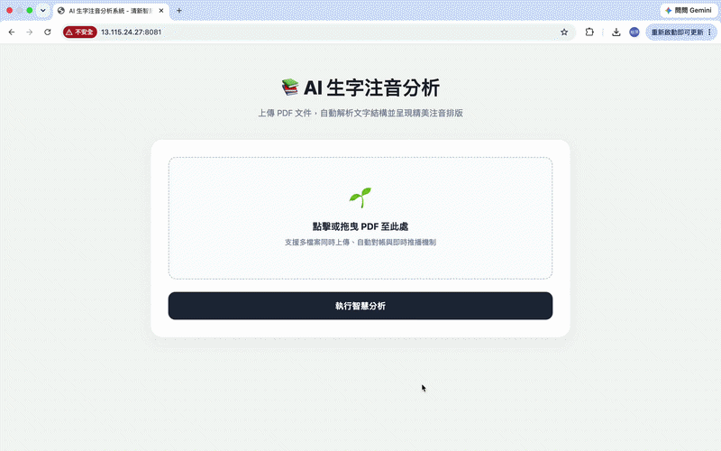
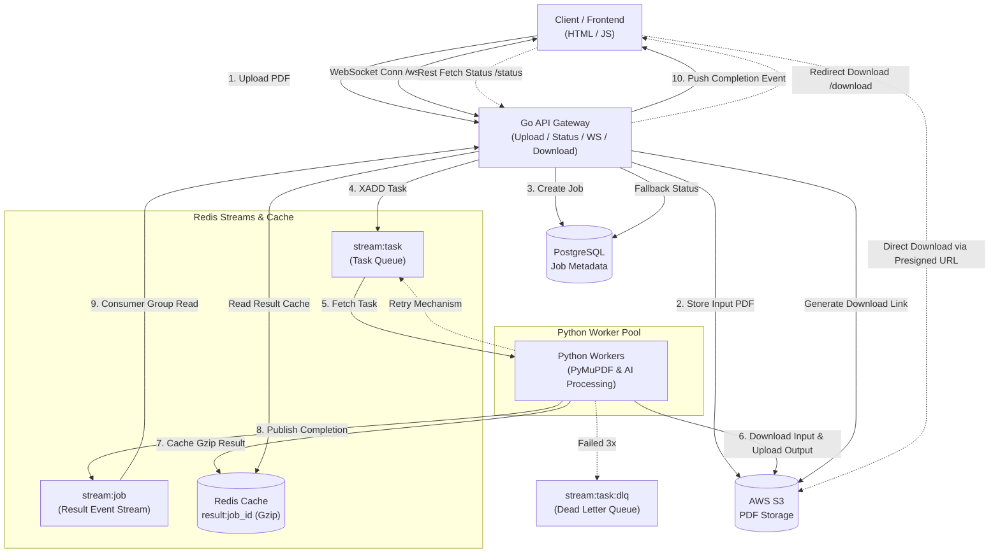
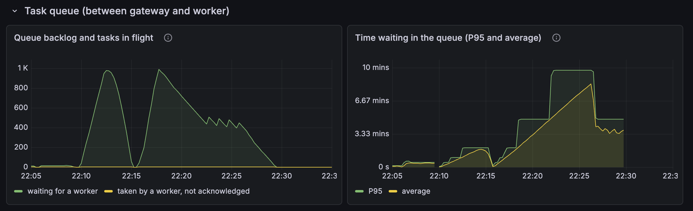

# Distributed Document Processing System

An event-driven distributed document processing system for asynchronous PDF Zhuyin (注音) annotation, built with **Go**, **Python**, **Redis Streams**, **PostgreSQL**, and **AWS S3**.

The system decouples request handling from document processing using Redis Streams Consumer Groups, enabling scalable background processing, fault tolerance, and real-time job tracking.

---

## Demo



---

## Highlights

### Scalable Processing
- Event-driven architecture using Redis Streams Consumer Groups
- Asynchronous document processing with a Go Gateway and Python worker pool

### Fault Tolerance
- Automatic retry mechanism
- Dead Letter Queue (DLQ)
- Pending message recovery using `XAUTOCLAIM`
- Reconciler that re-publishes jobs left `pending` after a crash between the database write and the queue write

### Distributed Storage
- AWS S3 for document storage
- PostgreSQL for job metadata
- Redis cache with Gzip-compressed annotation results

### DevOps
- Docker Compose deployment
- Automated CI/CD with GitHub Actions

### Observability and Load Testing
- Prometheus metrics (requests by status, task queue backlog, queue wait, worker processing time) and a provisioned Grafana dashboard
- k6 load tests; in the spike test with 1,000 virtual users the gateway answered every request (about 560 requests/s, 0 HTTP failures) and the worker CPU was identified as the bottleneck (see [Load Testing](#load-testing--system-benchmarks))

---

# System Architecture



A static version of this diagram: [`docs/images/system_architecture.png`](./docs/images/system_architecture.png).

---

# Tech Stack

| Layer | Technology |
|--------|------------|
| API Gateway | Go |
| Background Worker | Python |
| Message Queue | Redis Streams |
| Database | PostgreSQL |
| Object Storage | AWS S3 |
| Cache | Redis |
| Monitoring | Prometheus |
| Dashboard | Grafana |
| Load Testing | k6 |
| Containerization | Docker |
| CI/CD | GitHub Actions |

---

# Processing Flow

### 1. Upload

The client uploads a PDF through the Go API Gateway.

- PDF is uploaded to AWS S3
- Job metadata is stored in PostgreSQL
- A processing task is appended to Redis Streams

---

### 2. Background Processing

Python workers consume tasks through Redis Streams Consumer Groups.

Each worker:

- downloads the PDF from S3
- extracts document contents
- generates Zhuyin annotations
- renders the annotated PDF
- uploads the annotated document back to S3

---

### 3. Result Publication

After processing,

- annotation results are compressed with Gzip
- cached in Redis
- completion events are published back to Redis Streams
- the Gateway updates the job status

Clients can track progress via:
- WebSocket notifications: Instant push upon job completion.
- REST API (`GET /status`): Polls Redis cache with a database fallback for current job status.

---

### 4. File Download

Clients request document download via the Go API Gateway (`GET /download`).

- Gateway verifies job status from the Redis cache, and from PostgreSQL when the cache entry has expired.
- Gateway generates a short-lived (10-minute) **AWS S3 Presigned URL**.
- Gateway responds with an HTTP 302 Redirect to direct the client to download the rendered PDF straight from AWS S3, offloading file transfer traffic from the API Gateway.

---

# Features

## Event-driven Architecture

The system separates request handling from document processing by introducing Redis Streams between the API Gateway and worker pool.

This design enables

- asynchronous execution
- worker scalability
- loose coupling between services

---

## Fault Tolerance

Workers implement several reliability mechanisms.

### Consumer Groups

Multiple workers consume tasks concurrently and each task is delivered to one worker at a time. Delivery is **at-least-once**, so a task can occasionally be processed twice (for example after a worker crash); this is safe because the output key `outputs/<job_id>_translated.pdf` is deterministic and status updates overwrite.

### Retry

A failed task is not acknowledged, so it stays in the Pending Entries List and is picked up again by `XAUTOCLAIM` after it has been idle for 60 seconds (configurable), up to 3 deliveries.

### Pending Recovery

Workers periodically reclaim abandoned tasks using

```
XAUTOCLAIM
```

to recover jobs from crashed workers.

### Dead Letter Queue

Jobs that exceed the retry threshold are moved into a Dead Letter Queue for further inspection instead of being discarded. A task that was already delivered more than 3 times (an earlier delivery never finished, for example a worker killed by the out-of-memory killer) goes straight to the Dead Letter Queue without running again, and a `failed` event is published so the job does not stay `pending`.

### Worker supervision

The worker container starts several worker processes and replaces any that exit. Every service has `restart: unless-stopped`, and Redis runs with append-only persistence on a volume, so the queue state survives a restart.

### Reconciler

The upload handler writes to S3, then Postgres, then the queue. If the gateway crashes between the last two, the job would stay `pending` forever. A reconciler in the gateway re-publishes jobs that have been `pending` for more than 5 minutes, with a cooldown so a long queue is not enqueued again every minute. Under a deep backlog this can re-publish tasks that are only waiting, which makes workers do some duplicate work (known issue, measured in the load test below).

### Gateway event recovery

The gateway reads the workers' completion events through its own consumer group. It acknowledges an event only after the database status is written, and reclaims its own unacknowledged events after a restart.

---

## Distributed Storage

### AWS S3

Stores

- uploaded PDFs
- annotated PDFs

### PostgreSQL

Stores

- job status
- S3 object locations
- metadata

### Redis Cache

Stores compressed annotation results for fast status retrieval.

---

## Real-time Job Tracking

Clients can monitor processing progress through

- REST polling
- WebSocket notifications

without waiting for synchronous processing.

---

## CI/CD

The workflow in `.github/workflows/ci.yml` keeps checks and deployment separate:

| Event | What runs |
|---|---|
| Pull request to `master` | flake8 and `golangci-lint`, `pytest` and `go test -race`, `docker compose config` validation, and image builds (nothing is pushed or deployed) |
| Push to `master` (after a merge) | everything above, then the images are pushed to GHCR tagged `latest` and with the commit SHA, and the app is deployed to AWS EC2 |
| Manual run (`workflow_dispatch`) | same as a push; an optional `image_tag` input redeploys an earlier commit (rollback) |

Notes:
- Image builds wait for the tests, and deployment waits for the builds.
- Deployment only runs when the repository variable `DEPLOY_ENABLED` is `true`, so the pipeline does not fail while no host is running.
- The deploy job copies the compose file to the host, records the deployed tag as `IMAGE_TAG` in the host's `.env`, runs `docker compose pull` and `up -d`, and finishes with a smoke test against the gateway.

---

# Reliability Design

This project implements several production-inspired backend patterns.

| Feature | Implementation |
|----------|----------------|
| Message Queue | Redis Streams |
| Consumer Group | ✓ |
| Delivery semantics | At-least-once, idempotent outputs |
| Retry | Unacknowledged tasks reclaimed by `XAUTOCLAIM`, 3 deliveries |
| Pending Recovery | XAUTOCLAIM (workers and gateway) |
| Dead Letter Queue | ✓ (also for tasks that crashed a worker 3 times) |
| Dual-write gap (DB written, queue not) | Reconciler |
| Queue durability | Redis append-only file on a volume |
| Process supervision | Worker restart loop, `restart: unless-stopped` |
| Cache expiry | `/status` and `/download` fall back to PostgreSQL |
| Object Storage | AWS S3 |
| Metadata Database | PostgreSQL |
| Result Cache | Redis |
| Gzip Compression | ✓ |
| Multi-process Workers | ✓ |

---
# Load Testing & System Benchmarks

Testing coverage:
- Python (`pytest`) and Go (`go test -race`) unit tests, run on every pull request
- Integration and chaos tests against a real Redis and Postgres (worker killed mid-job, poison message, DLQ)
- k6 load tests: upload only, end to end (upload → status → download), spike and breakpoint

Measured on 2026-11-18 (commit `8a94d13`): one EC2 `c7i-flex.large` (2 vCPU) running everything in Docker Compose. k6 ran on a laptop over a regular network connection, so request rates reflect that link; CPU, processing time and queue figures come from the server. Full tables, method and limits: **[docs/benchmark-report.md](./docs/benchmark-report.md)**.

**What was run** (xs = 1 page, 15 characters; m = 10 pages, 6,169 characters; l = 30 pages, 22,200 characters):
- End to end: 20 virtual users, with xs, m and l.
- Spike (200 up to 1,000 virtual users) with xs and with m; breakpoint (0 up to 1,000) with m.
- Upload only (workers stopped): up to 100 virtual users.

## Results in four points

1. **The bottleneck is the worker CPU.** With the m and l documents the three workers use about 190% of the two cores. The gateway never used more than about 23% of one core.
2. **Each document costs CPU time that grows with its characters.** Dividing CPU use by the number of finished documents (inferred from these runs) gives about 0.95 s for the m document (6,169 characters) and 2.9 s for the l document (22,200 characters). Two cores can therefore finish about 2 m documents per second or 0.7 l documents per second; the runs measured 1.93 and 0.62 with the CPU about 93% busy.
3. **The queue absorbs the spike.** In the spike test with the smallest document (xs, 1 page) and up to 1,000 virtual users, the gateway answered all 169,319 HTTP requests without a failure, about 560 requests per second, most of them status polls. The tasks waited in Redis (up to 981 at once) and the queue was empty 16 seconds after the load stopped. With 10-page documents the same test behaved differently (see below).
4. **The extra time a user waits is queueing, not slower processing.** In the end-to-end test (20 users), the m document takes 1.5 s to process and its task waits 6.3 s in the queue; for l, 4.7 s against 23 s.

**What these numbers do not show**
- "1,000 users" are k6 virtual users looping through the whole flow, not 1,000 simultaneous connections.
- With 10-page documents the queue wait is longer than the time a simulated user polls (about 2 minutes in the spike test, 1.5 in the breakpoint test), so many gave up (738 of 1,033 and 294 of 531). Their tasks still finished later.
- The queues of the 10-page (m) spike test and breakpoint test took 998 s and 671 s to empty (the 1-page spike test: 16 s). Part of that is duplicate work: the reconciler, which re-sends jobs that look stuck, also re-sends tasks that are only waiting in a long queue. I did not measure it with the reconciler switched off.
- Upload was measured up to 100 users (88.75 uploads/s, gateway at 11% of one core). Above that the laptop's connection, not the gateway, was the limit, so I did not measure it.

## End to end, 20 virtual users

| Document | Flows/s | Flow time avg / P95 | Worker processing avg | Queue wait avg | Worker CPU avg (of 200%) | HTTP failures |
|---|---:|---|---:|---:|---:|---|
| xs, 1 page, 15 characters | 8.23 | 2.41 s / 3.02 s | 0.29 s | 0.34 s | 119% | 0 of 4,553 |
| m, 10 pages, 6,169 characters | 1.93 | 10.06 s / 11.39 s | 1.52 s | 6.26 s | 188% | 0 of 2,745 |
| l, 30 pages, 22,200 characters | 0.62 | 29.81 s / 34.21 s | 4.67 s | 23.10 s | 189% | 0 of 3,886 |

xs does not use up the CPU (119%); its speed is set by the users' loop. CPU figures are from `docker stats`, where 100% is one core.

## Charts

The Grafana captures and the CPU chart below cover **three tests in a row** on 2026-11-18. Axis times are UTC+8:

| Axis time | Test | Document | Virtual users |
|---|---|---|---|
| 22:05 to 22:09 | end to end (its last part) | l, 30 pages | 20 |
| 22:09 to 22:14 | spike | xs, 1 page | up to 1,000 |
| 22:15 on (queue empty about 22:29) | breakpoint | m, 10 pages | up to 1,000 |

The other tests (end to end with xs and m, spike with m) are not in these charts. More captures are in the [report](./docs/benchmark-report.md#4-dashboard-captures).


*Point 1, all three segments. Drawn from the `docker stats` samples taken during these tests (100% = one core). The workers stay near the 200% line; the gateway stays near the bottom.*


*Points 2 and 4, segments in order l, xs, m. About 0.6 documents/s and 4.7 s each for l, about 9.5 and 0.3 s for xs, about 2 and 1.5 s for m: the slower each document, the fewer finish per second.*


*Points 3 and 4. Left: tasks waiting for a worker. The xs spike (first hill; the l test before it barely shows) is empty about 16 s after the load stops; the m breakpoint test (second hill) needs about 11 minutes. Right: time waiting in the queue; the P95 line moves in steps because it is read from histogram buckets that stop at 600 s.*

---

# Project Structure

```
.
├── go-gateway/                 # Go API Gateway (HTTP & WebSocket Server)
│   ├── db/                     # sqlc generated database code
│   ├── sql/                    # SQL queries and schema
│   ├── index.html              # Static frontend page
│   ├── main.go                 # Gateway entry point & handlers
│   ├── job_events.go           # Consumer of the worker's completion events
│   ├── reconcile.go            # Reconciler for jobs stuck in pending
│   ├── queue_metrics.go        # Task queue backlog and in-flight metrics
│   ├── *_test.go               # Go unit and integration tests
│   ├── sqlc.yaml               # sqlc configuration
│   └── Dockerfile
│
├── python-worker/              # Python Background Worker (PDF Processing)
│   ├── models/                 # Data models (Job schema)
│   ├── processors/             # Core processing pipeline & AI engines
│   ├── services/               # PDF rendering & helper services
│   ├── fonts/                  # Custom fonts for rendering
│   ├── worker.py               # Worker entry point (Consumer Group logic)
│   ├── test_worker.py          # Python unit tests
│   ├── requirements.txt
│   └── Dockerfile
│
├── stress-test/                # k6 Performance & Load Testing
│   ├── breakpoint_test.js
│   ├── mixed_lifecycle_baseline.js   # spike test
│   ├── mixed_lifecycle_benchmark.js  # end-to-end, fixed VUs
│   ├── upload_baseline.js
│   ├── upload_benchmark.js
│   └── make_test_pdfs.py             # generates the m and l documents
│
├── prometheus/                 # Prometheus metrics configuration
├── grafana/                    # Grafana dashboard definitions
├── .github/
│   └── workflows/
│       └── ci.yml              # GitHub Actions CI/CD Pipeline
│
├── init.sql                    # PostgreSQL database initialization script
└── docker-compose.yml          # Multi-container local deployment

```
---
# Quick Start

### Prerequisites
- [Docker](https://www.docker.com/) & [Docker Compose](https://docs.docker.com/compose/)
- AWS Account with an active S3 Bucket and API credentials

---

### Local Setup & Execution

1. **Clone the repository:**
   ```bash
   git clone https://github.com/sodasmile1121/zhuyin-translator.git
   cd zhuyin-translator/
   ```

2. **Configure environment variables:** copy the template and fill it in.
   ```bash
   cp .env.example .env
   ```
   Required: `AWS_S3_BUCKET`, `POSTGRES_PASSWORD` (for example `openssl rand -hex 16`), `ADMIN_USER` and `ADMIN_PASSWORD` (the Grafana login). `.env` is ignored by git. Optional: `ALLOWED_ORIGINS` (defaults to `http://localhost:8081`; add the host's address to open the UI from another origin).

   The gateway and the worker reach S3 through the default AWS credential chain. On EC2, attach an IAM role with access to the bucket. Running anywhere else needs AWS credentials to be passed into the containers, which `docker-compose.yml` does not do yet.

3. **Start all services:**
   ```bash
   # pull the prebuilt images from GHCR (latest, or IMAGE_TAG from .env)
   docker compose up -d

   # or build the gateway and worker images from the local source
   docker compose -f docker-compose.yml -f docker-compose.dev.yml up -d --build
   ```

4. **Verify:**
   - Web UI & API Gateway: `http://localhost:8081`
   - Grafana: `http://localhost:3000`, Prometheus: `http://localhost:9090` (both listen on the host's localhost only; use an SSH tunnel on a remote host)
   - Postgres and Redis are only reachable inside the Docker network.

5. **Stop all services:**
   ```bash
   docker compose down
   ```
---

# Future Improvements

- Kubernetes deployment
- Horizontal worker auto scaling
- OpenTelemetry distributed tracing
- Rate limiting
- Upload benchmark above 100 virtual users from a wired network or a second host (the laptop's Wi‑Fi upload bandwidth was the limit)
- Avoid duplicate work when the reconciler re-publishes tasks that are only waiting in a long queue
- Distributed metrics aggregation

---

# License

This project is intended for educational and portfolio purposes.