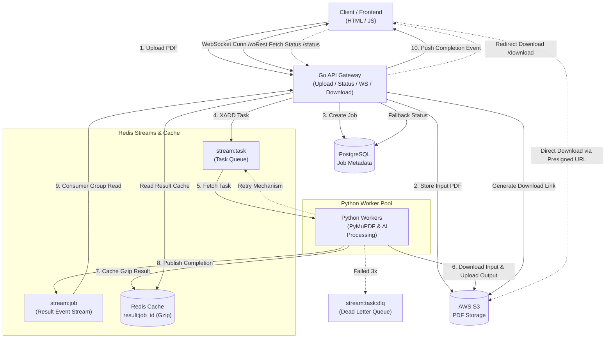
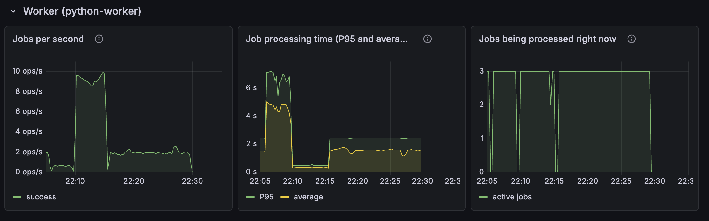
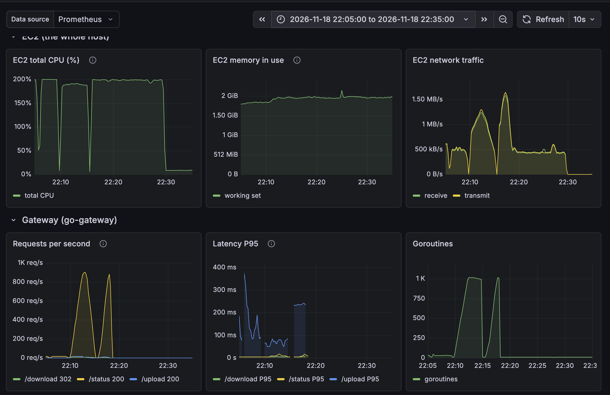

# Distributed Document Processing System

An event-driven distributed document processing system for asynchronous PDF Zhuyin (注音) annotation, built with **Go**, **Python**, **Redis Streams**, **PostgreSQL**, and **AWS S3**.

The system decouples request handling from document processing using Redis Streams Consumer Groups, enabling scalable background processing, fault tolerance, and real-time job tracking.

---

## Demo


---

## Highlights

### Scalable Processing
- Event-driven architecture using Redis Streams Consumer Groups
- Asynchronous document processing with a Go Gateway and Python worker pool

### Fault Tolerance
- Automatic retry mechanism
- Dead Letter Queue (DLQ)
- Pending message recovery using `XAUTOCLAIM`
- Reconciler that re-publishes jobs left `pending` after a crash between the database write and the queue write

### Distributed Storage
- AWS S3 for document storage
- PostgreSQL for job metadata
- Redis cache with Gzip-compressed annotation results

### DevOps
- Docker Compose deployment
- Automated CI/CD with GitHub Actions

### Observability and Load Testing
- Prometheus metrics (requests by status, task queue backlog, queue wait, worker processing time) and a provisioned Grafana dashboard
- k6 load tests; in the spike test with 1,000 virtual users the gateway served about 560 req/s with 0 HTTP failures at about 10% CPU, and the worker CPU was identified as the bottleneck (see [Load Testing](#load-testing--system-benchmarks))

---

# System Architecture



A static version of this diagram: [`docs/images/system_architecture.png`](./docs/images/system_architecture.png).

---

# Tech Stack

| Layer | Technology |
|--------|------------|
| API Gateway | Go |
| Background Worker | Python |
| Message Queue | Redis Streams |
| Database | PostgreSQL |
| Object Storage | AWS S3 |
| Cache | Redis |
| Monitoring | Prometheus |
| Dashboard | Grafana |
| Load Testing | k6 |
| Containerization | Docker |
| CI/CD | GitHub Actions |

---

# Processing Flow

### 1. Upload

The client uploads a PDF through the Go API Gateway.

- PDF is uploaded to AWS S3
- Job metadata is stored in PostgreSQL
- A processing task is appended to Redis Streams

---

### 2. Background Processing

Python workers consume tasks through Redis Streams Consumer Groups.

Each worker:

- downloads the PDF from S3
- extracts document contents
- generates Zhuyin annotations
- renders the annotated PDF
- uploads the annotated document back to S3

---

### 3. Result Publication

After processing,

- annotation results are compressed with Gzip
- cached in Redis
- completion events are published back to Redis Streams
- the Gateway updates the job status

Clients can track progress via:
- WebSocket notifications: Instant push upon job completion.
- REST API (`GET /status`): Polls Redis cache with a database fallback for current job status.

---

### 4. File Download

Clients request document download via the Go API Gateway (`GET /download`).

- Gateway verifies job status from the Redis cache, and from PostgreSQL when the cache entry has expired.
- Gateway generates a short-lived (10-minute) **AWS S3 Presigned URL**.
- Gateway responds with an HTTP 302 Redirect to direct the client to download the rendered PDF straight from AWS S3, offloading file transfer traffic from the API Gateway.

---

# Features

## Event-driven Architecture

The system separates request handling from document processing by introducing Redis Streams between the API Gateway and worker pool.

This design enables

- asynchronous execution
- worker scalability
- loose coupling between services

---

## Fault Tolerance

Workers implement several reliability mechanisms.

### Consumer Groups

Multiple workers consume tasks concurrently and each task is delivered to one worker at a time. Delivery is **at-least-once**, so a task can occasionally be processed twice (for example after a worker crash); this is safe because the output key `outputs/<job_id>_translated.pdf` is deterministic and status updates overwrite.

### Retry

A failed task is not acknowledged, so it stays in the Pending Entries List and is picked up again by `XAUTOCLAIM` after it has been idle for 60 seconds (configurable), up to 3 deliveries.

### Pending Recovery

Workers periodically reclaim abandoned tasks using

```
XAUTOCLAIM
```

to recover jobs from crashed workers.

### Dead Letter Queue

Jobs that exceed the retry threshold are moved into a Dead Letter Queue for further inspection instead of being discarded. A task that was already delivered more than 3 times (an earlier delivery never finished, for example a worker killed by the out-of-memory killer) goes straight to the Dead Letter Queue without running again, and a `failed` event is published so the job does not stay `pending`.

### Worker supervision

The worker container starts several worker processes and replaces any that exit. Every service has `restart: unless-stopped`, and Redis runs with append-only persistence on a volume, so the queue state survives a restart.

### Reconciler

The upload handler writes to S3, then Postgres, then the queue. If the gateway crashes between the last two, the job would stay `pending` forever. A reconciler in the gateway re-publishes jobs that have been `pending` for more than 5 minutes, with a cooldown so a long queue is not enqueued again every minute. Under a deep backlog this can re-publish tasks that are only waiting, which makes workers do some duplicate work (known issue, measured in the load test below).

### Gateway event recovery

The gateway reads the workers' completion events through its own consumer group. It acknowledges an event only after the database status is written, and reclaims its own unacknowledged events after a restart.

---

## Distributed Storage

### AWS S3

Stores

- uploaded PDFs
- annotated PDFs

### PostgreSQL

Stores

- job status
- S3 object locations
- metadata

### Redis Cache

Stores compressed annotation results for fast status retrieval.

---

## Real-time Job Tracking

Clients can monitor processing progress through

- REST polling
- WebSocket notifications

without waiting for synchronous processing.

---

## CI/CD

The workflow in `.github/workflows/ci.yml` keeps checks and deployment separate:

| Event | What runs |
|---|---|
| Pull request to `master` | flake8 and `golangci-lint`, `pytest` and `go test -race`, `docker compose config` validation, and image builds (nothing is pushed or deployed) |
| Push to `master` (after a merge) | everything above, then the images are pushed to GHCR tagged `latest` and with the commit SHA, and the app is deployed to AWS EC2 |
| Manual run (`workflow_dispatch`) | same as a push; an optional `image_tag` input redeploys an earlier commit (rollback) |

Notes:
- Image builds wait for the tests, and deployment waits for the builds.
- Deployment only runs when the repository variable `DEPLOY_ENABLED` is `true`, so the pipeline does not fail while no host is running.
- The deploy job copies the compose file to the host, records the deployed tag as `IMAGE_TAG` in the host's `.env`, runs `docker compose pull` and `up -d`, and finishes with a smoke test against the gateway.

---

# Reliability Design

This project implements several production-inspired backend patterns.

| Feature | Implementation |
|----------|----------------|
| Message Queue | Redis Streams |
| Consumer Group | ✓ |
| Delivery semantics | At-least-once, idempotent outputs |
| Retry | Unacknowledged tasks reclaimed by `XAUTOCLAIM`, 3 deliveries |
| Pending Recovery | XAUTOCLAIM (workers and gateway) |
| Dead Letter Queue | ✓ (also for tasks that crashed a worker 3 times) |
| Dual-write gap (DB written, queue not) | Reconciler |
| Queue durability | Redis append-only file on a volume |
| Process supervision | Worker restart loop, `restart: unless-stopped` |
| Cache expiry | `/status` and `/download` fall back to PostgreSQL |
| Object Storage | AWS S3 |
| Metadata Database | PostgreSQL |
| Result Cache | Redis |
| Gzip Compression | ✓ |
| Multi-process Workers | ✓ |

---
# Load Testing & System Benchmarks

Current testing coverage includes:
- Python (`pytest`) and Go (`go test -race`) unit tests, run on every pull request
- Integration and chaos tests against a real Redis and Postgres (worker killed mid-job, Redis restart, poison message)
- k6 load tests: upload-only, end-to-end lifecycle (upload → status → download), spike and breakpoint

**Setup (one complete run, 2026-11-18, code at commit `8a94d13`):** one EC2 `c7i-flex.large` (2 vCPU) running the whole stack in Docker Compose (gateway, 3 worker processes, Redis, Postgres, Prometheus, Grafana). k6 ran on a laptop over a café Wi‑Fi, so the request rates below are what that link could carry; the worker CPU, processing time and queue numbers are measured on the server and do not depend on the network. Raw outputs and the report are in `docs/evidence/bench-2026-11-18/`.

Three document sizes are used, because the worker's cost grows with the number of characters:

| Size | File | Characters |
|---|---|---:|
| xs | `stress-test/test.pdf`, 1 page | 15 |
| m | 10 pages | 6,169 |
| l | 30 pages | 22,200 |

(`stress-test/make_test_pdfs.py` generates m and l.)

---

## 1. End-to-end, 20 virtual users

Complete workflow `upload → poll status → worker → download`, 20 users in a loop.

| Document | Flows/s | Flow time avg / P95 | Worker processing avg | Worker CPU avg (of 200%) | HTTP failures |
|---|---:|---|---:|---:|---:|
| xs | 8.23 | 2.41 s / 3.02 s | 0.29 s | 119% | 0 of 4,553 |
| m | 1.93 | 10.06 s / 11.39 s | 1.52 s | 188% | 0 of 2,745 |
| l | 0.62 | 29.81 s / 34.21 s | 4.67 s | 189% | 0 of 3,886 |

> **Key finding: the bottleneck is the worker CPU, and its cost scales with document size.** For m and l the three workers use about 190% of the 2 vCPUs. Cost per document is roughly **0.19 s of CPU + 0.13 s per 1,000 characters**, so capacity ≈ 2 vCPU ÷ cost: about 2.0 documents/s for m (measured 1.93) and 0.65/s for l (measured 0.62). The xs run is not CPU-saturated (119%); its rate is set by the client loop, not by a limit of the system. The extra time users see is queue wait, not slower processing (m: 6.3 s queue wait vs 1.5 s processing).

---

## 2. Spike (200 → 1,000 users) and breakpoint (0 → 1,000 users)

| Test | HTTP requests/s | HTTP failures | Peak queue backlog | Queue wait while k6 ran, avg / P95 (see note) | Queue empty after k6 ended | Flows that gave up waiting (60 s) |
|---|---:|---:|---:|---|---:|---:|
| spike, xs | 564 | 0 of 169,319 | 981 | 61.5 s / 114.3 s | 16 s | 0 of 2,421 |
| spike, m | 559 | 0 of 167,585 | 1,274 | 120.9 s / 281.9 s | 998 s | 738 of 1,033 |
| breakpoint, m | 510 | 0 of 81,665 | 990 | 59.5 s / 117.0 s | 671 s | 294 of 531 |

> **Key finding: the queue absorbs the spike; the gateway is not the bottleneck.** With 1,000 users the gateway answered every HTTP request (0 failures) at about 10% CPU while the workers were at 170–180%. The work waits in Redis Streams instead of failing: the backlog peaks near 1,000 tasks and drains afterwards.
>
> **Queue wait column:** it covers only the tasks the workers finished while k6 was running. Tasks that were still waiting when k6 stopped finished during the drain and are not in it, so for the m tests the real waits were much longer: the dashboard below shows the average wait of the breakpoint m test climbing to about 8 minutes (P95 about 10 minutes).

The three dashboard captures below come from the Grafana instance on the same host (times are 14:05 to 14:35 UTC on 2026-11-18, shown in UTC+8 on the axes as 22:05 to 22:35). The window contains two tests one after the other: the xs spike starting at about 22:09 and the m breakpoint test starting at about 22:15.


*Left: tasks waiting for a worker. The xs spike (first hill) is empty about 16 s after k6 stops; the m breakpoint test (second hill) takes about 11 minutes to drain. Right: time waiting in the queue.*


*Workers finish about 9 to 10 xs documents per second but only about 2 m documents per second, and all three are busy for the whole run: the worker pool is the bottleneck.*


*The host CPU is at about 200% (both cores) while the gateway serves up to about 900 requests/s. The CPU panel is host-wide, not per container.*

> **What the table does not say:** for m documents, 60 s is shorter than the queue wait, so many simulated users gave up waiting for their result (738 of 1,033 in the spike); the tasks still completed later. The long drain times for m (671 s and 998 s) are also stretched by a known flaw (review item G61): the reconciler re-publishes tasks that are only waiting in the queue, so workers do some duplicate work (results are unchanged because outputs are idempotent). It was not measured with the reconciler off. Two of the drain times were taken from the sampled queue depth, because the harness of that day mis-measured them.

---

## 3. Upload only (worker stopped), 2 minutes per level

| Users | Uploads/s | Upload handler P95 | Gateway CPU avg | HTTP failures |
|---:|---:|---:|---:|---:|
| 10 | 8.96 | 0.050 s | 1% | 0 of 1,080 |
| 50 | 44.55 | 0.083 s | 5% | 0 of 5,396 |
| 100 | 88.75 | 0.090 s | 11% | 0 of 10,745 |

> Throughput scales linearly up to 100 users, with the gateway at 11% CPU. Higher levels were **not measured**: from the laptop's Wi‑Fi the upload bandwidth (about 0.8 MB/s) is the limit above roughly 50 users, so a higher level would measure the Wi‑Fi, not the gateway. An earlier table with 200–1,000 users (about 380 requests/s) came from a previous setup whose raw data is not kept, so it was removed rather than mixed with this run.

---

## 4. Observability

Prometheus (5 s scrape) and a provisioned Grafana dashboard (`grafana/provisioning/dashboards/zhuyin-pipeline.json`) show request counts by status, task queue backlog and in-flight tasks, queue wait time, worker jobs and processing time, and host CPU, memory and network. Per-container CPU is not shown (cAdvisor cannot name containers on this Docker version); `docker stats` was sampled during the tests instead.

---
# Project Structure

```
.
├── go-gateway/                 # Go API Gateway (HTTP & WebSocket Server)
│   ├── db/                     # sqlc generated database code
│   ├── sql/                    # SQL queries and schema
│   ├── index.html              # Static frontend page
│   ├── main.go                 # Gateway entry point & handlers
│   ├── job_events.go           # Consumer of the worker's completion events
│   ├── reconcile.go            # Reconciler for jobs stuck in pending
│   ├── queue_metrics.go        # Task queue backlog and in-flight metrics
│   ├── *_test.go               # Go unit and integration tests
│   ├── sqlc.yaml               # sqlc configuration
│   └── Dockerfile
│
├── python-worker/              # Python Background Worker (PDF Processing)
│   ├── models/                 # Data models (Job schema)
│   ├── processors/             # Core processing pipeline & AI engines
│   ├── services/               # PDF rendering & helper services
│   ├── fonts/                  # Custom fonts for rendering
│   ├── worker.py               # Worker entry point (Consumer Group logic)
│   ├── test_worker.py          # Python unit tests
│   ├── requirements.txt
│   └── Dockerfile
│
├── stress-test/                # k6 Performance & Load Testing
│   ├── breakpoint_test.js
│   ├── mixed_lifecycle_baseline.js   # spike test
│   ├── mixed_lifecycle_benchmark.js  # end-to-end, fixed VUs
│   ├── upload_baseline.js
│   ├── upload_benchmark.js
│   └── make_test_pdfs.py             # generates the m and l documents
│
├── prometheus/                 # Prometheus metrics configuration
├── grafana/                    # Grafana dashboard definitions
├── .github/
│   └── workflows/
│       └── ci.yml              # GitHub Actions CI/CD Pipeline
│
├── init.sql                    # PostgreSQL database initialization script
└── docker-compose.yml          # Multi-container local deployment

```
---
# Quick Start

### Prerequisites
- [Docker](https://www.docker.com/) & [Docker Compose](https://docs.docker.com/compose/)
- AWS Account with an active S3 Bucket and API credentials

---

### Local Setup & Execution

1. **Clone the repository:**
   ```bash
   git clone https://github.com/sodasmile1121/zhuyin-translator.git
   cd zhuyin-translator/
   ```

2. **Configure environment variables:** copy the template and fill it in.
   ```bash
   cp .env.example .env
   ```
   Required: `AWS_S3_BUCKET`, `POSTGRES_PASSWORD` (for example `openssl rand -hex 16`), `ADMIN_USER` and `ADMIN_PASSWORD` (the Grafana login). `.env` is ignored by git. Optional: `ALLOWED_ORIGINS` (defaults to `http://localhost:8081`; add the host's address to open the UI from another origin).

   The gateway and the worker reach S3 through the default AWS credential chain. On EC2, attach an IAM role with access to the bucket. Running anywhere else needs AWS credentials to be passed into the containers, which `docker-compose.yml` does not do yet.

3. **Start all services:**
   ```bash
   # pull the prebuilt images from GHCR (latest, or IMAGE_TAG from .env)
   docker compose up -d

   # or build the gateway and worker images from the local source
   docker compose -f docker-compose.yml -f docker-compose.dev.yml up -d --build
   ```

4. **Verify:**
   - Web UI & API Gateway: `http://localhost:8081`
   - Grafana: `http://localhost:3000`, Prometheus: `http://localhost:9090` (both listen on the host's localhost only; use an SSH tunnel on a remote host)
   - Postgres and Redis are only reachable inside the Docker network.

5. **Stop all services:**
   ```bash
   docker compose down
   ```
---

# Future Improvements

- Kubernetes deployment
- Horizontal worker auto scaling
- OpenTelemetry distributed tracing
- Rate limiting
- Upload benchmark above 100 virtual users from a wired network or a second host (the laptop's Wi‑Fi upload bandwidth was the limit)
- Avoid duplicate work when the reconciler re-publishes tasks that are only waiting in a long queue
- Distributed metrics aggregation

---

# License

This project is intended for educational and portfolio purposes.