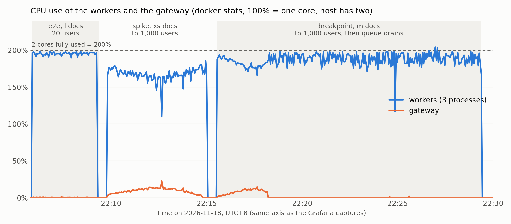
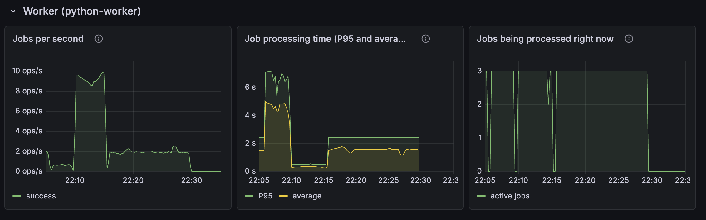
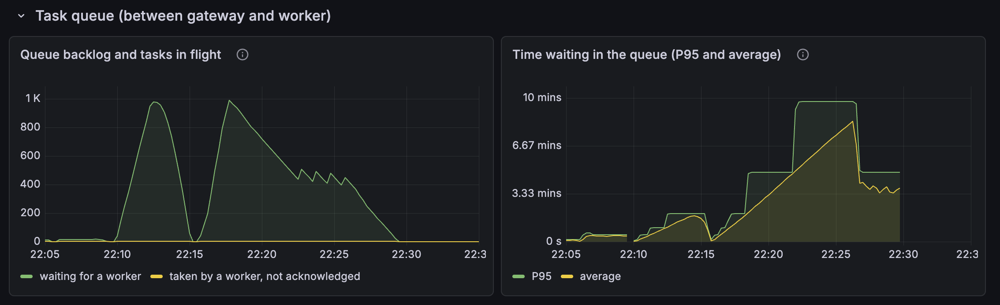
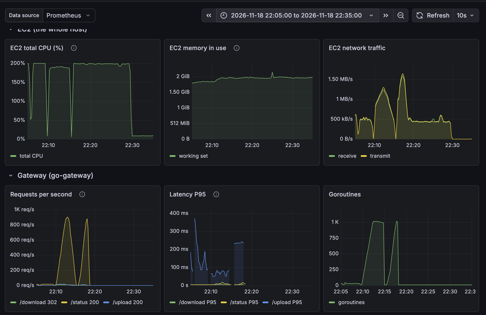

# Load-test report (2026-11-18)

This is the detailed report behind the summary in the [README](../README.md#load-testing--system-benchmarks). It covers one complete run of the k6 tests against the application on a single AWS EC2 host. The raw k6 outputs and the sampled `docker stats` files are not committed to the repository.

## Setup

- **System under test:** one EC2 `c7i-flex.large` (2 vCPU, 4 GiB) running everything in Docker Compose: the Go gateway, 3 Python worker processes, Redis, Postgres, Prometheus, Grafana and cAdvisor. Code at commit `8a94d13`.
- **Load generator:** k6 on a laptop, over a regular network connection to the host. Request rates therefore reflect that link. Worker CPU, processing time and queue figures are measured on the server and do not depend on the network.
- **CPU figures:** from `docker stats`, sampled every 3 to 4 seconds during each test. **100% means one core**, and the host has two, so 200% is the ceiling. A value slightly above 200% is sampling noise.
- **"Users" are k6 virtual users**, each running the whole flow in a loop (upload, poll status, download). They are not 1,000 simultaneous connections.

Three document sizes are used, because the worker's cost grows with the number of characters:

| Size | File | Pages | Characters | File size |
|---|---|---:|---:|---:|
| xs | `stress-test/test.pdf` | 1 | 15 | 7,816 bytes |
| m | `stress-test/pdfs/doc_m.pdf` | 10 | 6,169 | 30,155 bytes |
| l | `stress-test/pdfs/doc_l.pdf` | 30 | 22,200 | 47,041 bytes |

`stress-test/make_test_pdfs.py` generates m and l.

| # | Test | Document | Users | k6 script |
|---|---|---|---|---|
| 1 | end-to-end | xs | 20 | `mixed_lifecycle_benchmark.js` |
| 2 | end-to-end | m | 20 | `mixed_lifecycle_benchmark.js` |
| 3 | end-to-end | l (3 minutes) | 20 | `mixed_lifecycle_benchmark.js` |
| 4 | spike | xs | 200, then up to 1,000 | `mixed_lifecycle_baseline.js` |
| 5 | spike | m | 200, then up to 1,000 | `mixed_lifecycle_baseline.js` |
| 6 | breakpoint | m | 0 up to 1,000 | `breakpoint_test.js` |
| 7 | upload only, workers stopped | xs | 10, 50, 100 | `upload_benchmark.js` |

## 1. End to end, 20 virtual users

| Document | Flows/s | Flow time avg / P95 | Worker processing avg / P95 | Queue wait avg / P95 | Worker CPU avg / max | Host CPU avg (cores of 2) | HTTP failures |
|---|---:|---|---|---|---|---:|---|
| xs | 8.23 | 2.41 s / 3.02 s | 0.29 s / 0.48 s | 0.34 s / 0.93 s | 119% / 179% | 1.42 | 0 of 4,553 |
| m | 1.93 | 10.06 s / 11.39 s | 1.52 s / 2.42 s | 6.26 s / 9.74 s | 188% / 197% | 1.86 | 0 of 2,745 |
| l | 0.62 | 29.81 s / 34.21 s | 4.67 s / 6.89 s | 23.10 s / 29.11 s | 189% / 198% | 1.87 | 0 of 3,886 |

- For m and l the three workers use about 190% of the two cores, so the worker pool is the bottleneck. The xs run is not CPU-bound (119%): its rate is set by the users' loop, not by a system limit.
- The time a user waits is mostly queueing, not slower processing. For m the processing takes 1.5 s but the task waits 6.3 s; for l, 4.7 s against 23 s. For m and l, with 20 users and 3 workers, about 17 tasks are always waiting.

### CPU cost per document

Dividing the host's CPU use by the number of finished documents gives the CPU time one document costs:

| Document | Host CPU avg × test seconds ÷ documents finished | CPU time per document |
|---|---|---:|
| xs | 1.421 × 122 ÷ 1,045 | 0.17 s |
| m | 1.858 × 129 ÷ 251.7 | 0.95 s |
| l | 1.87 × 211 ÷ 134.5 | 2.93 s |

Reading it:

- Two cores can therefore finish about 2.1 m documents or 0.7 l documents per second at full use. The runs measured 1.93 and 0.62 with the CPU about 93% busy.
- Another way to see the same thing: with all three workers busy, throughput is about 3 ÷ the processing time per document (m: 3 ÷ 1.52 ≈ 2.0 per second; l: 3 ÷ 4.67 ≈ 0.64 per second).
- **This is an inference from these runs, not an independent prediction.** There are only two saturated points (m and l), a straight line always fits two points, and the host CPU also includes the gateway, Redis, Postgres and status polling. The xs run does not fit because it never saturated the CPU.

## 2. Spike and breakpoint

| Test | HTTP requests/s | HTTP failures | Peak queue backlog | Queue empty after k6 ended | Flows that gave up waiting | Worker CPU avg / max | Gateway CPU avg / max |
|---|---:|---|---:|---:|---|---|---|
| spike, xs | 564 | 0 of 169,319 | 981 | 16 s | 0 of 2,421 | 167% / 181% | 10% / 23% |
| spike, m | 559 | 0 of 167,585 | 1,274 | 998 s | 738 of 1,033 | 180% / 194% | 9% / 15% |
| breakpoint, m | 510 | 0 of 81,665 | 990 | 671 s | 294 of 531 | 182% / 194% | 8% / 15% |

CPU columns are averages and maxima over the time k6 ran.

- **The queue absorbs the spike.** With up to 1,000 users the gateway answered every HTTP request while the workers were the busy part. Most requests are status polls, so the request rate is not an upload rate.
- **Not every user got a result (m documents).** A simulated user polls the status for a limited time and then gives up: up to 120 polls (about 2 minutes) in the spike tests, 90 polls (about 1.5 minutes) in the breakpoint test. At the end k6 also cuts off users who are still waiting: it gives a user it removes one minute to finish, then stops it. With m documents the queue wait is longer than both limits, so most flows ended without a result (table below). Their tasks were uploaded and finished later, during the drain.
- **Requests per second are not worker throughput.** k6 counts a flow as done even when it gave up.
- **Queue wait, measured while k6 ran.** From Prometheus over the k6 window only: spike xs 61.5 s average / 114.3 s P95, spike m 120.9 s / 281.9 s, breakpoint m 59.5 s / 117.0 s. Tasks still waiting when k6 stopped finished during the drain and are not in these numbers, so for the m tests the real waits were longer (figure below). The wait histogram stops at 600 s, so the P95 of the breakpoint test is "more than 10 minutes", not an exact value. The average line in the Grafana panel is a rolling value, not the average over the whole test.
- **Duplicate work (a known flaw).** The reconciler re-sends jobs that look stuck. Under a deep backlog it also re-sends tasks that are only waiting in the queue, so the workers did some duplicate work and the m tests took longer to drain. Results are unchanged because outputs are idempotent. This was not measured with the reconciler switched off. The surplus matches the gateway log (table below).

How the flows of the two m tests ended (k6) and how much work the workers did (Prometheus, test plus drain):

| Test | Flows started | Got a result | Gave up | Cut off when k6 stopped | Uploads accepted | Tasks the workers finished | Tasks the reconciler re-sent (log) |
|---|---:|---:|---:|---:|---:|---:|---:|
| spike, m | 1,722 | 295 | 738 | 698 | 1,728 | 2,563 | 831 |
| breakpoint, m | 1,229 | 237 | 294 | 711 | 1,236 | 1,620 | 382 |

"Flows started" is k6's completed plus cut-off iterations; the gateway counts a few more uploads (6 and 7), a difference at the edges of the measurement window. The workers finished more tasks than there were uploads (834 and 384 more), which is about what the reconciler re-sent.

## 3. Upload only (workers stopped), 2 minutes per level

| Users | Uploads/s | Upload handler P95 | k6 request P95 | Gateway CPU avg / max | Host CPU avg (cores of 2) | HTTP failures |
|---:|---:|---:|---:|---|---:|---|
| 10 | 8.96 | 0.050 s | 171.7 ms | 1% / 2% | 0.09 | 0 of 1,080 |
| 50 | 44.55 | 0.083 s | 175.0 ms | 5% / 7% | 0.15 | 0 of 5,396 |
| 100 | 88.75 | 0.090 s | 184.3 ms | 11% / 16% | 0.22 | 0 of 10,745 |

Throughput scales linearly up to 100 users. Higher levels were not measured: from the laptop's connection the upload bandwidth (about 0.8 MB/s) was the limit above roughly 50 users, so a higher level would have measured the connection, not the gateway.

## 4. Dashboard captures

The captures come from Grafana on the same host. The time range holds **three tests in a row**, shown in UTC+8 on the axes:

| Axis time | Test |
|---|---|
| 22:05 to 22:09 | end of the end-to-end test with the 30-page document (l, 20 users) |
| 22:09 to 22:14 | spike with the 1-page document (xs, up to 1,000 users) |
| 22:15 on | breakpoint with the 10-page document (m, up to 1,000 users); the queue drains until about 22:29 |


*Drawn from the `docker stats` samples taken during these three tests, not from Grafana. The workers stay near the 200% line (two cores); the gateway stays near the bottom. In the breakpoint section the workers average 187% over the whole section, including the drain; the table above gives 182% for the time k6 ran.*


*The three segments are visible: about 0.6 documents/s and 4.7 s per document for l, about 9.5 documents/s and 0.3 s for xs, about 2 documents/s and 1.5 s for m. All three workers are busy throughout.*


*Left: tasks waiting for a worker. The xs spike (first hill) is empty about 16 s after k6 stops. The m breakpoint test (second hill) takes about 11 minutes to drain. Right: time waiting in the queue; the P95 line moves in steps because it is read from histogram buckets (up to 600 s).*


*The host CPU is at about 200% while the gateway serves up to about 900 requests per second. The CPU panel is host-wide, not per container (cAdvisor cannot name containers on this Docker version).*

## What was not measured

- Upload above 100 users (see section 3).
- The duplicate work from the reconciler, with the reconciler switched off.
- Per-container CPU in Grafana; the container figures come from `docker stats`.
- Anything from a clean machine other than the EC2 host.

## Reproducing

```bash
python3 stress-test/make_test_pdfs.py        # from stress-test/
k6 run -e PDF_FILE=./pdfs/doc_m.pdf -e VUS=20 -e TARGET_URL=http://<host>:8081 mixed_lifecycle_benchmark.js
k6 run -e PDF_FILE=./pdfs/doc_m.pdf -e TARGET_URL=http://<host>:8081 mixed_lifecycle_baseline.js
k6 run -e PDF_FILE=./pdfs/doc_m.pdf -e TARGET_URL=http://<host>:8081 breakpoint_test.js
k6 run -e VUS=100 -e TARGET_URL=http://<host>:8081 upload_benchmark.js
```

Start k6 from a connection that can carry the load: a quick check is to request a tiny route such as `/status?job_id=x` with a few hundred users before the real test.
